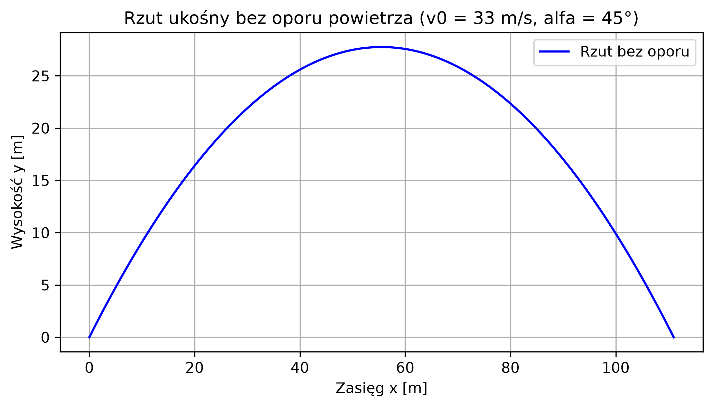

# Raport z symulacji rzutu ukośnego

## 1. Wstęp i parametry początkowe
Celem niniejszego ćwiczenia jest analiza ruchu pocisku rzuconego ukośnie w polu grawitacyjnym Ziemi, zarówno w warunkach idealnych (bez oporu powietrza), jak i z uwzględnieniem oporu ośrodka.

Parametry symulacji wyznaczone na podstawie numeru indeksu ($337645$):
* **Prędkość początkowa ($v_0$):** $33 \, \text{m/s}$
* **Kąt rzutu ($\alpha$):** $45^\circ$
* **Przyspieszenie ziemskie ($g$):** $9.81 \, \text{m/s}^2$

---

## 2. Rzut ukośny bez oporu powietrza
W modelowaniu teoretycznym pomijamy oddziaływanie cząsteczek powietrza. Równania ruchu w postaci parametrycznej przyjmują postać:

$$x(t) = v_0 \cos(\alpha) \cdot t$$
$$y(t) = v_0 \sin(\alpha) \cdot t - \frac{1}{2} g t^2$$

### Wykres trajektorii ruchu (bez oporu)

---

## 3. Rzut ukośny z oporem powietrza
W rzeczywistych warunkach na poruszający się obiekt działa siła oporu powietrza proporcjonalna do kwadratu prędkości ($F_{op} = k \cdot v^2$). Do rozwiązania układu równań różniczkowych zastosowano numeryczną metodę Eulera z krokiem czasowym $\Delta t = 0.001 \, \text{s}$.

### Porównanie trajektorii (z oporem i bez oporu)

---

## 4. Podsumowanie i wnioski
1. Uwzględnienie oporu powietrza znacząco skraca maksymalny zasięg oraz wysokość, jaką osiąga pocisk.
2. Symulacja numeryczna pozwala na dokładne odwzorowanie rzeczywistego toru lotu, którego nie da się opisać analitycznie za pomocą prostych wzorów algebraicznych.