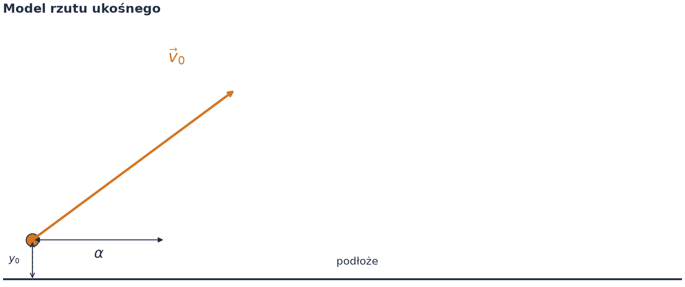
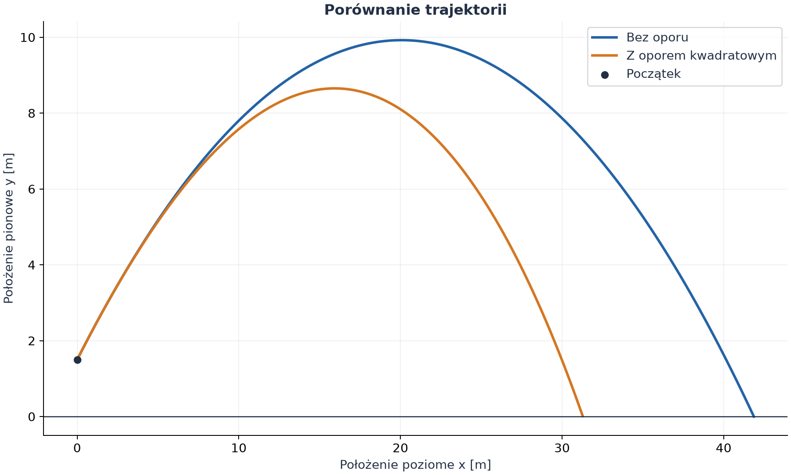
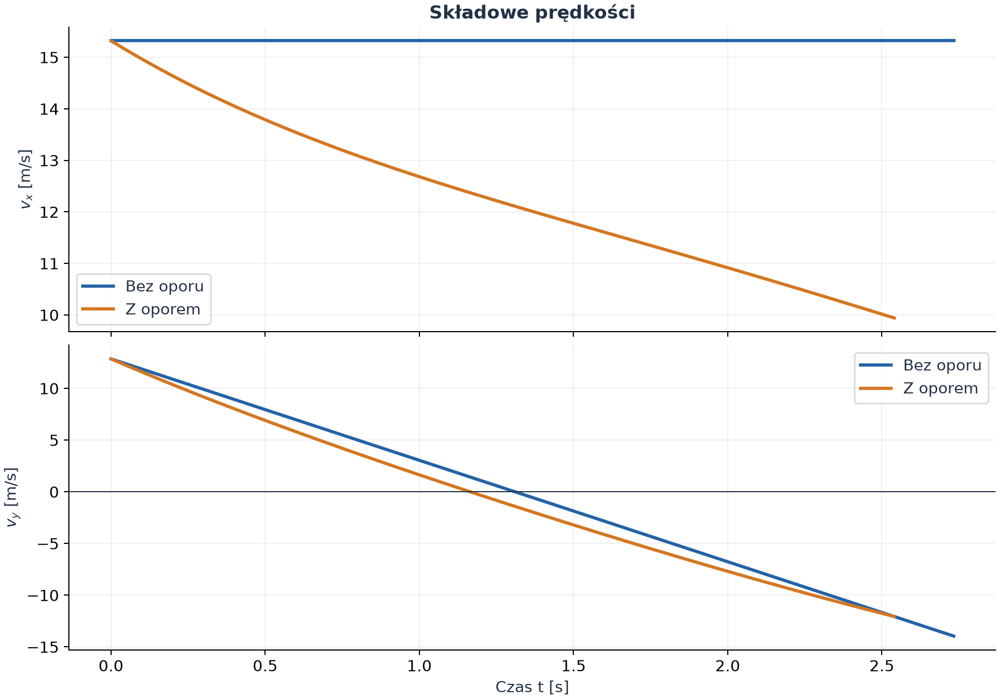
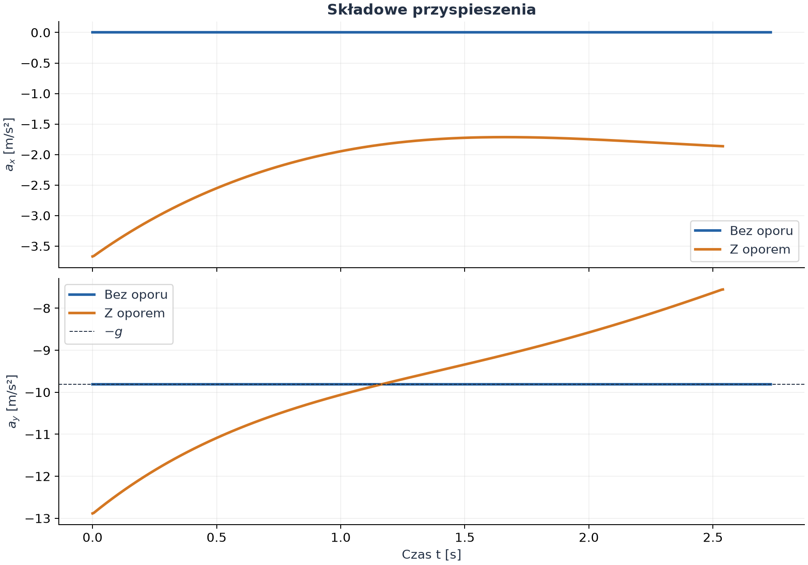
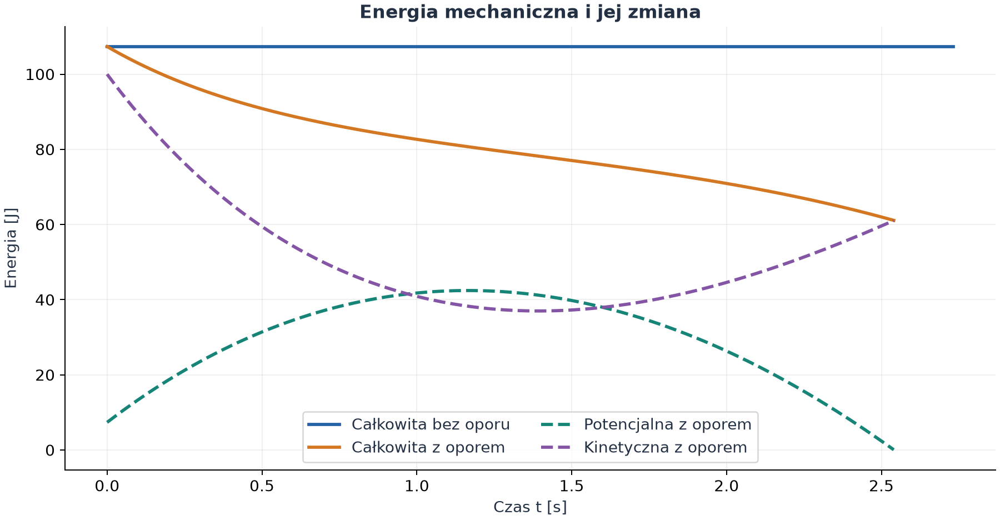
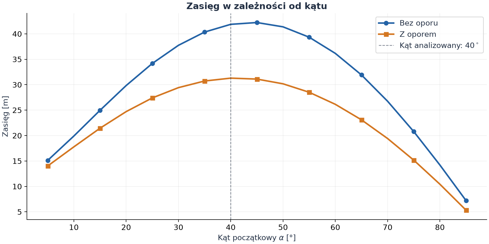

# Rzut ukośny — bez oporu i z oporem powietrza

*Raport obliczeniowy: ruch punktu materialnego w jednorodnym polu grawitacyjnym.*

**Temat:** rzut ukośny z pominięciem oporu oraz z oporem kwadratowym.  
**Metoda:** rozwiązanie analityczne i symulacja numeryczna w Pythonie.  
**Charakter danych:** dane modelowe; wykresy przedstawiają obliczenia, a nie pomiary laboratoryjne.

W świecie idealnym pozioma składowa prędkości pozostaje stała, a pionowa zmienia się jednostajnie. W rzeczywistych warunkach siła oporu powietrza zależy od prędkości i powoduje utratę energii mechanicznej oraz skrócenie zasięgu.


## Spis treści

1. [Cel i model fizyczny](#1-cel-i-model-fizyczny)
2. [Równania ruchu](#2-równania-ruchu)
3. [Przykład liczbowy](#3-przykład-liczbowy)
4. [Porównanie trajektorii i prędkości](#4-porównanie-trajektorii-i-prędkości)
5. [Energia w obu modelach](#5-energia-w-obu-modelach)
6. [Zasięg i kąt rzutu](#6-zasięg-i-kąt-rzutu)
7. [Kod i odtwarzanie wykresów](#7-kod-i-odtwarzanie-wykresów)
8. [Wnioski](#8-wnioski)

---

## 1. Cel i model fizyczny

Celem raportu jest opisanie ruchu ciała, porównanie rozwiązania bez oporu z ruchem przy oporze powietrza oraz sprawdzenie wpływu kąta rzutu na zasięg.

### 1.1. Założenia

- Ciało traktujemy jako punkt materialny o masie $m$.
- Ziemię i jej pole grawitacyjne przyjmujemy za układ jednorodny.
- Przyspieszenie ziemskie jest stałe i wynosi $g=9{,}81\,\mathrm{m/s^2}$.
- W pierwszym modelu pomijamy opór powietrza.
- W drugim modelu przyjmujemy siłę oporu kwadratową:

$$
\vec F_d=-c\,|\vec v|\,\vec v,
$$

gdzie $c$ jest współczynnikiem oporu i $\vec v$ oznacza prędkość ciała.



*Rysunek 1. Początkową prędkość $v_0$ rozkładamy na składową poziomą i pionową.*

### 1.2. Symbole i jednostki

| Symbol | Znaczenie | Jednostka SI |
| :--- | :--- | :---: |
| $x$, $y$ | położenie poziome i pionowe | $\mathrm{m}$ |
| $v_x$, $v_y$ | składowe prędkości | $\mathrm{m/s}$ |
| $a_x$, $a_y$ | składowe przyspieszenia | $\mathrm{m/s^2}$ |
| $v_0$, $\alpha$ | prędkość i kąt początkowy | $\mathrm{m/s}$, rad |
| $m$ | masa ciała | $\mathrm{kg}$ |
| $c$ | współczynnik oporu kwadratowego | $\mathrm{kg/m}$ |
| $g$ | przyspieszenie ziemskie | $\mathrm{m/s^2}$ |

---

## 2. Równania ruchu

### 2.1. Ruch bez oporu

Na ciało działa tylko siła ciężkości:

$$
m\ddot{x}=0,
\qquad
m\ddot{y}=-mg.
$$

Dla stanu początkowego $x(0)=x_0$, $y(0)=y_0$ oraz prędkości:

$$
v_{x0}=v_0\cos\alpha,
\qquad
v_{y0}=v_0\sin\alpha
$$

otrzymujemy:

$$
x(t)=x_0+v_0\cos(\alpha)t,
$$

$$
y(t)=y_0+v_0\sin(\alpha)t-\frac{1}{2}gt^2,
$$

$$
v_x(t)=v_0\cos\alpha,
\qquad
v_y(t)=v_0\sin\alpha-gt.
$$

Czas lotu do wysokości $y=0$ wynosi:

$$
T=\frac{v_{y0}+\sqrt{v_{y0}^{2}+2gy_0}}{g},
$$

a zasięg:

$$
Z=x(T)-x_0=v_{x0}T.
$$

Maksymalna wysokość liczona od podłoża wynosi $y_0+v_{y0}^{2}/(2g)$.

### 2.2. Ruch z oporem kwadratowym

Dla oporu proporcjonalnego do kwadratu prędkości zapisujemy:

$$
\vec F_d=-c|\vec v|\vec v.
$$

Równania ruchu mają postać:

$$
\dot x=v_x,
\qquad
\dot y=v_y,
$$

$$
\dot v_x=-\frac{c}{m}|\vec v|v_x,
\qquad
\dot v_y=-g-\frac{c}{m}|\vec v|v_y.
$$

Nie ma tu prostego rozwiązania algebraicznego dla wspólnego ruchu w dwóch kierunkach. Układ można jednak w sposób powtarzalny obliczyć numerycznie metodą `solve_ivp`.

Siła oporu zawsze działa przeciwnie do wektora prędkości. W przeciwieństwie do przypadku idealnego spowalnia ona zarówno składową poziomą, jak i pionową.

---

## 3. Przykład liczbowy

Przyjęto następujące parametry:

| Wielkość | Wartość |
| :--- | ---: |
| Masa $m$ | $0{,}50\,\mathrm{kg}$ |
| Prędkość początkowa $v_0$ | $20{,}0\,\mathrm{m/s}$ |
| Kąt początkowy $\alpha$ | $40^\circ$ |
| Początkowa wysokość $y_0$ | $1{,}50\,\mathrm{m}$ |
| Przyspieszenie ziemskie $g$ | $9{,}81\,\mathrm{m/s^2}$ |
| Współczynnik oporu $c$ | $0{,}006\,\mathrm{kg/m}$ |

Początkowe składowe prędkości wynoszą:

$$
v_{x0}=20\cos40^\circ\approx15{,}32\,\mathrm{m/s},
$$

$$
v_{y0}=20\sin40^\circ\approx12{,}86\,\mathrm{m/s}.
$$

W modelu bez oporu czas lotu wynosi około $2{,}73\,\mathrm{s}$, zasięg około $41{,}9\,\mathrm{m}$, a maksymalna wysokość około $9{,}92\,\mathrm{m}$. Przy oporze kwadratowym wartości te są mniejsze, ponieważ część energii mechanicznej przechodzi do otaczającego powietrza.

---

## 4. Porównanie trajektorii i prędkości

W modelu idealnym pozioma składowa prędkości pozostaje stała. Z oporem maleje ona wraz z czasem, dlatego ciało dociera bliżej punktu rzutu.

Na wykresie pionowej prędkości można sprawdzić miejsce zerowania $v_y$. Odpowiada ono czasowi osiągnięcia maksymalnej wysokości.



*Rysunek 2. Opór skraca zasięg i zmienia kształt trajektorii. Tor bez oporu jest parabolą.*



*Rysunek 3. Bez oporu $v_x$ jest stała, a $v_y$ maleje liniowo. Z oporem obie składowe są zmieniane przez siłę oporu.*

Przyspieszenie w modelu idealnym jest stałe i pionowe:

$$
a_x=0,
\qquad
a_y=-g.
$$

Z oporem kwadratowym składowe przyspieszenia mają postać:

$$
a_x=-\frac{c}{m}|\vec v|v_x,
\qquad
a_y=-g-\frac{c}{m}|\vec v|v_y.
$$



*Rysunek 4. Przyspieszenie z oporem nie jest stałe, ponieważ siła oporu zależy od chwilowej prędkości.*

---

## 5. Energia w obu modelach

Energia kinetyczna i potencjalna wynoszą:

$$
E_k=\frac{1}{2}m(v_x^2+v_y^2),
\qquad
E_p=mgy.
$$

Suma mechaniczna bez oporu spełnia:

$$
\frac{d}{dt}(E_k+E_p)=0.
$$

Z oporem całkowita energia mechaniczna maleje. Moc tracona na opór wynosi:

$$
P_d=\vec F_d\cdot\vec v
=-c|\vec v|^3\leq0.
$$

Można to zapisać:

$$
\frac{dE_m}{dt}=-c|\vec v|^3.
$$

Strata nie jest bezpośrednio równoważona przez tylko jedną składową energii, ale przez obie składowe prędkości i zmianę wysokości.



*Rysunek 5. W modelu bez oporu energia całkowita jest stała. Z oporem maleje w całym czasie lotu.*

---

## 6. Zasięg i kąt rzutu

Dla danego punktu początkowego i prędkości początkowej optymalny kąt zależy od warunków. Bez oporu i dla rzutu z tego samego poziomu co podłoże maksimum zasięgu występuje przy $\alpha=45^\circ$.

Gdy wysokość początkowa $y_0>0$, wzór ten ulega niewielkiej zmianie, a maksimum przesuwa się ku niższemu kątowi. Z oporem zależność nie ma prostego wzoru analitycznego i trzeba ją wyznaczyć z symulacji.



*Rysunek 6. Porównanie zasięgu dla kątów od $5^\circ$ do $85^\circ$ przy $v_0=20\,\mathrm{m/s}$.*

---

## 7. Kod i odtwarzanie wykresów

Wykresy wygenerowano w Pythonie z użyciem NumPy i Matplotlib. Numerycznym rozwiązaniem równań zajmuje się SciPy.

Lokalnie możesz uruchomić dołączony skrypt:

```bash
python -m pip install numpy matplotlib scipy
python generuj_rzut_ukosny.py
```

Skrypt zapisuje obrazy do katalogu `files/rzut_ukosny`. Uruchom go z katalogu raportu:

```text
pages/examples/01_markdown/
```

W Google Colab możesz skopiować poniższy schemat:

```python
import numpy as np
from scipy.integrate import solve_ivp

g = 9.81
m = 0.50
c = 0.006

def rhs(t, s):
    x, y, vx, vy = s
    v = np.hypot(vx, vy)
    return [vx, vy, -(c/m)*v*vx, -g-(c/m)*v*vy]

sol = solve_ivp(
    rhs, (0, 10),
    [0, 1.5, 20*np.cos(np.deg2rad(40)),
     20*np.sin(np.deg2rad(40))],
    rtol=1e-10, atol=1e-12
)
```

---

## 8. Wnioski

1. Bez oporu ruch jest opisany przez równania paraboliczne, a pozioma prędkość jest stała.
2. Z oporem kwadratowym obie składowe prędkości maleją pod wpływem siły przeciwdziałającej ruchowi.
3. Tor z oporem nie jest idealną parabolą, a zasięg i maksymalna wysokość są zwykle mniejsze.
4. Energia mechaniczna jest stała tylko w modelu idealnym; z oporem maleje z szybkością $c|\vec v|^3$.
5. Wyniki numeryczne powinny być porównane z rozwiązaniem analitycznym jako kontrola podstawowego modelu.

### Lista kontrolna raportu

- [x] Zdefiniowano układ współrzędnych i parametry.
- [x] Wyprowadzono rozwiązanie dla ruchu bez oporu.
- [x] Zapisano równania z oporem kwadratowym.
- [x] Porównano trajektorie, prędkości i przyspieszenia.
- [x] Sprawdzono zmianę energii.
- [x] Dołączono kod do odtworzenia wykresów.
