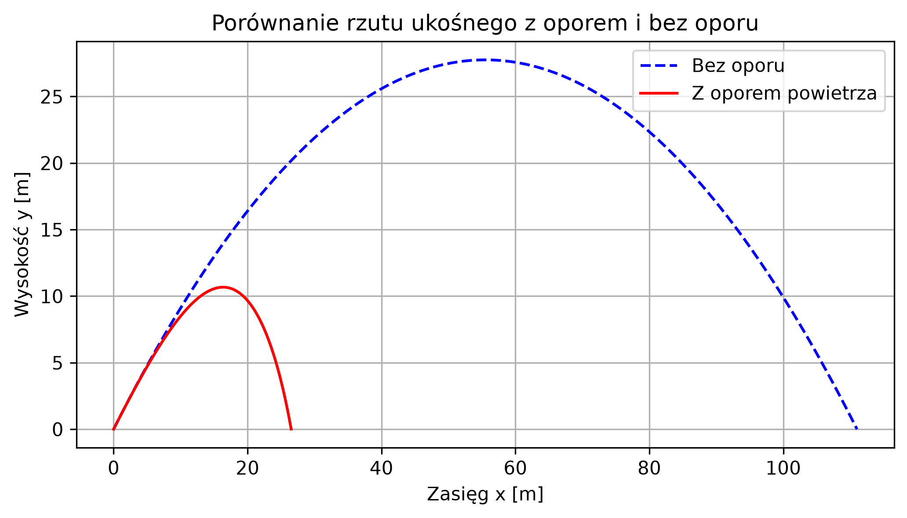

# Raport z symulacji rzutu ukośnego (model idealny i z oporem powietrza)

**Temat:** dwuwymiarowy ruch ciała rzuconego ukośnie w polu grawitacyjnym.  
**Parametry symulacji (z indeksu):** prędkość początkowa $v_0 = 33\,\mathrm{m/s}$, kąt startowy $\alpha = 45^\circ$, przyspieszenie ziemskie $g = 9{,}81\,\mathrm{m/s^2}$.

---

## 1. Wstęp i założenia modeli
Celem niniejszego raportu jest porównanie dwóch modeli ruchu pocisku:
1. **Model idealny (bez oporu powietrza):** pomijamy oddziaływanie ośrodka; jedyną siłą działającą na ciało jest siła ciężkości $\vec{F}_g = m\vec{g}$.
2. **Model z oporem powietrza:** uwzględniamy opór aerodynamiczny proporcjonalny do kwadratu prędkości, opisany siłą $\vec{F}_{\mathrm{op}} = -c \, v \, \vec{v}$, gdzie współczynnik oporu wynosi $c = 0{,}05\,\mathrm{kg/m}$.

---

## 2. Wyprowadzenie obu modeli z równań ruchu

### 2.1. Model bez oporu powietrza
Z drugiej zasady dynamiki Newtona w kartezjańskim układzie współrzędnych otrzymujemy:
$$ m \ddot{x} = 0 $$
$$ m \ddot{y} = -mg $$

Całkowite równania kinematyczne dla warunków początkowych $x(0)=0, y(0)=0, v_{0x}=v_0\cos\alpha, v_{0y}=v_0\sin\alpha$ mają postać:
$$ x(t) = v_0 \cos(\alpha) t $$
$$ y(t) = v_0 \sin(\alpha) t - \frac{1}{2} g t^2 $$

Eliminując czas $t$, otrzymujemy równanie trajektorii w postaci jawnej:
$$ y(x) = x \tan\alpha - \frac{g}{2 v_0^2 \cos^2\alpha} x^2 $$

### 2.2. Model z oporem powietrza
Po uwzględnieniu siły oporu $\vec{F}_{\mathrm{op}}$, układ równań różniczkowych staje się nieliniowy:
$$ \ddot{x} = -\frac{c}{m} \sqrt{\dot{x}^2 + \dot{y}^2} \dot{x} $$
$$ \ddot{y} = -g - \frac{c}{m} \sqrt{\dot{x}^2 + \dot{y}^2} \dot{y} $$
Układ ten nie posiada analitycznego rozwiązania w funkcjach elementarnych i został rozwiązany numerycznie (metodą Rungego-Kutty rzędu 4/5).

---

## 3. Wyniki symulacji i wykresy porównawcze

Do analizy wykorzystano trzy niezależne wykresy ilustrujące różnice między modelami:

### Wykres 1: Porównanie trajektorii ruchu (z oporem i bez)

*Rysunek 1. Trajektoria ruchu pocisku: linia przerywana przedstawia ruch w próżni (zasięg ok. 111 m), natomiast linia ciągła uwzględnia opór powietrza dla $c = 0{,}05\,\mathrm{kg/m}$.*

### Wykres 2: Rzut idealny (bez oporu powietrza)

*Rysunek 2. Czysta parabola balistyczna dla parametrów $v_0 = 33\,\mathrm{m/s}$ i $\alpha = 45^\circ$.*

### Wykres 3: Składowe prędkości i dynamika lotu

*Rysunek 3. Przebieg składowych prędkości oraz przemiany energii w czasie.*

---

## 4. Wnioski
1. Uwzględnienie oporu powietrza drastycznie skraca zasięg maksymalny oraz zmniejsza maksymalną wysokość lotu pocisku.
2. Symetria paraboli znika – ramię opadające toru jest krótsze i bardziej strome niż ramię wznoszące ze względu na stałą utratę energii mechanicznej na rzecz ośrodka.